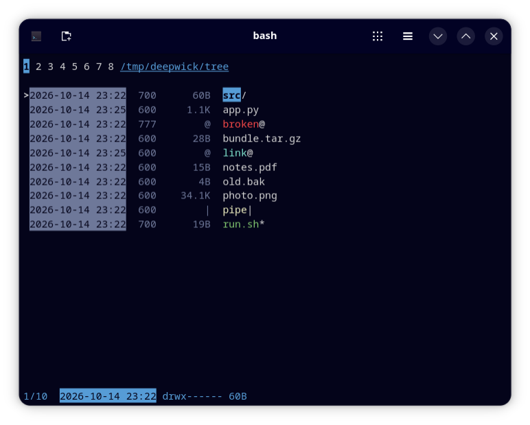

# Deepwick for nnn

Deepwick colors for [nnn](https://github.com/jarun/nnn).

> Deepwick is an unofficial theme derived from
> [Polywick Blue](https://vscode.polywickstudio.net) by Polywick Studio (MIT).
> Not affiliated with Polywick Studio.



## Install

bash or zsh, in `~/.bashrc` or `~/.zshrc`:

```sh
source /path/to/deepwick/nnn/deepwick.sh
```

fish, in `~/.config/fish/config.fish`:

```fish
source /path/to/deepwick/nnn/deepwick.fish
```

## Notes

- nnn supports only 256-color indices, not 24-bit hex colors. This theme
  uses the 16 ANSI slots, so it looks right with a Deepwick terminal theme
  ([Ptyxis](https://github.com/deepwick/ptyxis),
  [Konsole](https://github.com/deepwick/konsole),
  [Alacritty](https://github.com/deepwick/alacritty),
  [Ghostty](https://github.com/deepwick/ghostty)).
- Directories Blue (nnn always draws them bold), executables bright green,
  symlinks bright cyan, hard links Light Blue, broken links Red, details
  Muted. Devices, FIFOs and sockets use the yellow and magenta slots, because
  Gold has no ANSI slot.
- nnn colors only file types. It cannot color by extension (archives, media,
  documents), and its date column is always reversed.
- Empty regular files take the "unknown" color (Red), as nnn intends.

Tested with nnn 5.3.

## License

MIT. See [LICENSE](LICENSE).
